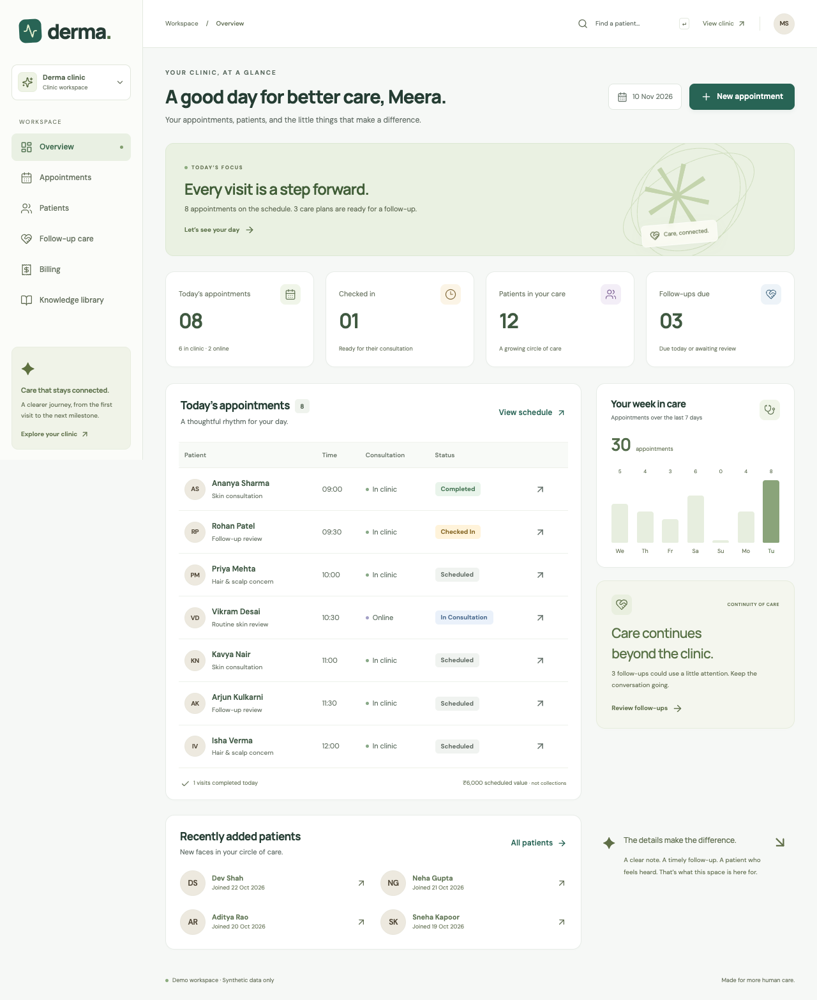

# Derma — care, connected

A working dermatology clinic and patient-care platform, built from the supplied **Dermatology Clinic Platform Concept Document**. It connects public discovery, booking, clinic operations, longitudinal records, treatment communication, and follow-up in one responsive application.



This is a **single-clinic release** with a real API, database, authentication, role permissions, and synthetic demonstration accounts. It does not need paid services to run locally.

## Start the demo

Requires **Node.js 24** and npm.

```sh
npm ci
npm run dev
```

Open **http://127.0.0.1:5173**. Choose **Sign in**, then a demo role. Data is persisted in `data/clinic.sqlite`; restarting the app does not reset changes.

| Role          | Email                  | Password          |
| ------------- | ---------------------- | ----------------- |
| Doctor        | `doctor@derma.demo`    | `DemoClinic2026!` |
| Reception     | `reception@derma.demo` | `DemoClinic2026!` |
| Patient       | `patient@derma.demo`   | `DemoClinic2026!` |
| Administrator | `admin@derma.demo`     | `DemoClinic2026!` |

These are intentionally public **development-only credentials**. Production startup rejects demo mode and demo databases. All demo people, qualifications, clinical notes, and treatment examples are fictional.

## What works

- **Discovery:** doctor profiles, focus areas, qualifications, languages, consultation fees, and clinic contact information.
- **Booking:** in-person or online appointments, live availability, protection against overlapping doctor and patient bookings, rescheduling, cancellation, check-in, consultation progression, no-shows, and `.ics` calendar export with the recorded visit duration.
- **Waitlist:** patient and reception requests with a preferred clinician, mode and date window; explicit confirmation before booking; atomic appointment linkage, withdrawal and retained history. Requests do not reserve slots.
- **Availability:** per-doctor weekly sessions, breaks, consultation modes, 15/20/30/45/60-minute appointments, doctor leave, and clinic-wide closures. Schedule changes protect existing bookings.
- **Clinic workspace:** daily dashboard, seven-day appointment activity, searchable patients, registration, and follow-up worklists.
- **Patient preparation:** a structured four-step history intake, reviewable summary, explicit sharing agreement, and clinician access to submitted history.
- **Longitudinal records:** original consultation notes with dated, attributed amendments, shared history, private images, treatment plans, and side-by-side image comparison. Original notes and amendments remain clinician-only.
- **Image annotations:** clinician-authored rectangle, ellipse and arrow overlays with text notes, preserved originals, private revision history, and explicit sharing of a saved revision. Keyboard controls use image-relative positions; no measurements or diagnoses are inferred.
- **Care summary:** a printable patient-facing snapshot and revision-checked JSON download for patients and clinicians, with shared history, treatment, results, procedures, attachment metadata and invoices. Internal notes, private annotations, private messages and file bytes are excluded.
- **Investigations:** structured test requests, due dates and instructions, patient/clinician result submissions, PDF attachments, and clinician reviews that are shared with the patient only after explicit publication. Supplemental results require review of the newest submission.
- **Procedure records:** documented indication, benefits, risks, alternatives, estimated cost and aftercare; patient agree/decline decisions and their history; clinician completion and outcome records. These record a discussion and decision, not a validated legal e-signature.
- **PDF reports:** private uploads up to 5 MB, original-file retention, source/author/date metadata, SHA-256 file fingerprints, and authorized downloads. Uploading a report does not interpret its medical contents.
- **Treatment communication:** clinician-entered medication instructions, schedules, duration, expectations, costs, precautions, and follow-up dates. Patients can review both active and completed plans.
- **Follow-up:** daily patient-reported check-ins, worklists for due reviews and new reports, assignable clinical ownership, clinician assessments, shared next steps, requested visits, and documented completion. Reviews preserve the exact report versions considered; corrected reports return to the review queue.
- **Activity inbox:** private in-app updates for messages, appointments, waitlist changes, invoices and received payments, patient reports, shared investigation findings, procedures, and follow-up reviews; unread counts, explicit read controls, pagination, and links to the underlying record. Reading an update does not complete a clinical review.
- **Billing:** itemized invoices, exact integer-paise arithmetic, recorded cash/card/UPI/bank payments, partial balances, printable invoices, and private patient invoice access. Procedures can link to one invoice with staff-entered agreed charges; estimates are never charged automatically. Invoice and payment retries are idempotent.
- **Clinic reports:** administrator date-range reports for appointment activity, invoices issued, payments recorded and incurred expenses, with daily series and aggregate CSV export. Current outstanding relates to invoices issued in the selected range.
- **Expenses:** administrator-only expense records with exact paise amounts, categories, references, safe retries, and attributed void history that preserves the original entry.
- **Consumable inventory:** staff-visible catalogue and lot balances, administrator receipts, usage and physical-count reconciliation, expiry/low-stock filters, safe retries, and immutable movement/catalogue history. Whole units are tracked without automatic dispensing or charges.
- **Knowledge library:** clinician-authored drafts, explicit review before public publication, search, and retained article revisions. No AI-generated clinical claims are presented as approved information.
- **Administration:** clinic details, doctor profiles, staff accounts, optional module switches, activity logs, and verified portal access for an existing clinic patient. Pausing a module stops new activity while preserving access to existing records.
- **Accounts and access:** searchable account management, staff-role/profile changes, suspension/restoration without deleting records, required initial-password changes, and protection against removing the last active administrator. Patients and staff cannot be converted into each other or linked to different patient records.
- **Account security:** password hashing, HTTP-only sessions, CSRF and ownership checks, throttling, an active-session inventory, individual or bulk session revocation, and administrator-assisted password recovery using a one-use link that expires after 30 minutes.
- **Mobile:** responsive layouts, mobile navigation, keyboard-accessible dialogs, printable records, and a standalone web-app manifest. Private medical records are not cached for offline use.

## Try an end-to-end journey

1. Open the public clinic and explore the doctor profiles.
2. Create a patient account, prepare a history, and book an available future slot.
3. Sign in as Doctor, find the patient, and add a consultation note, care plan, and investigation request.
4. Return to the patient account to view the plan, report a daily check-in, send a message, and share a PDF result under **My health record → Tests & procedures**.
5. Review the result as Doctor and explicitly publish the patient-facing summary. In **Follow-up care**, open **Review progress**, document an assessment and patient instructions, and choose whether to continue follow-up, request a visit, or complete the plan.
6. Return to the patient account to read the new instructions and next review date. Open **Activity** for related updates; marking one read does not mark the care as reviewed.
7. Create an invoice in Billing, record a payment already received, and view the balance in the patient portal.

Reception can manage appointments, demographics, and billing. Clinicians can access clinic-wide clinical records. Administrators additionally manage accounts, configuration, expense records, clinic reports and the audit log. Patients can access only their own protected records. Internal consultation notes, their amendments, follow-up assessments and report snapshots, and unpublished investigation reviews remain clinician-only; structured care plans and published reviews carry the patient-facing instructions.

If reception registers a patient first, an administrator can use **Clinic settings → Your team → Patient portal access** after verifying identity. This links an account to the existing record; the system never links records just because an unverified email matches. Newly provisioned staff and patient accounts must replace their initial password before accessing private workspaces. Existing demo accounts are ready to explore without this step.

## Review clinic activity and expenses

Administrators can open **Clinic reports** to choose a date range, compare daily activity and download an aggregate CSV. Appointment counts use scheduled dates and current statuses. Issued invoices use their creation date; recorded collections use the date staff entered each received payment. Expenses use the incurred date entered in the ledger. Reporting dates use Asia/Kolkata.

The outstanding figure is the current balance of invoices issued within the selected range, not a reconstructed balance on that period’s last day. Collections can relate to older invoices. Reports keep these measures separate and do not present them as profit or clinical outcomes. Exports contain aggregate amounts and counts, without patient identities or individual expense descriptions.

Use **Expenses** to record a clinic expense with its date, category, amount and optional reference. If an entry is mistaken, void it with a reason and record a replacement if needed. The original amount, author and void history remain available. A voided expense is excluded from current aggregates; it does not reverse a bank transaction or prove that money was returned.

## Set availability and manage access

In **Availability & time off**, administrators can manage every doctor’s weekly sessions and clinic-wide closures. Doctors can edit their own linked profile’s hours and time off; reception can view availability. Split a day into separate sessions for breaks, choose each session’s consultation mode, and select the doctor’s appointment length. Existing profiles default to Monday–Saturday, 09:00–18:00 with 30-minute visits until changed. A schedule or closure that would invalidate an existing future booking is rejected; reschedule or cancel the affected visit first.

In **Accounts & access**, an administrator can suspend access, restore an account, change a staff role, or issue a recovery link after verifying the account holder’s identity. Role/profile/access changes end that account’s sessions. Recovery links are shown once, must be shared privately by the clinic, and are never automatically emailed or messaged. Issuing a new link invalidates the previous one; successful recovery ends all previous sessions and requires a fresh sign-in.

Every signed-in person can use **Account & security** to change their password, see their active browser sessions, and end sessions they no longer need. Session labels describe the browser family; they are not verified device identities or locations.

## Coordinate a waiting patient

Patients can join the waitlist from **My care** or booking. Reception can add requests in **Waitlist**, filter by doctor and status, and contact the patient using the recorded phone number. A request records a clinician, consultation mode and inclusive date window. One active request is allowed per patient, clinician and mode. It does not reserve time or send an external offer.

After the patient confirms a specific slot, staff can book directly from the request. The appointment and booked state save together; a conflict leaves the request waiting. Patients can also choose and confirm their own available slot. Withdrawn, booked and expired requests remain in history. Cancelling the resulting appointment does not automatically reopen the old request.

For procedure charges, open **Procedure billing** from the clinical record or choose a procedure when creating an invoice. Reception sees the procedure title, estimate and billing status without clinical discussion or outcomes. Enter agreed amounts explicitly. Each procedure links to one invoice, and reopening the action displays that invoice. Cancelling a procedure preserves an already issued invoice; refunds and adjustments are not automated.

## Track clinic consumables

Open **Inventory** to inspect the catalogue, lot balances and stock history. Administrators create items with a fixed SKU and counting unit, then record receipts against individual lots. Count complete pieces, pairs, packs, boxes or bottles consistently; the app does not convert units or calculate medication doses.

Each receipt creates a distinct lot with an optional supplier lot code and exact expiry date. Usage subtracts from a selected lot. A physical count records the observed balance and an attributed adjustment with a reason, preserving earlier receipts and movements. An expired lot cannot be used; a stock count can still record disposal or a correction. Archived items preserve their history and can be reactivated.

Expiry follows Asia/Kolkata: a lot becomes expired the day after its recorded expiry date, and the expiring-soon filter covers today through the next 30 days. A missing date is shown as **No expiry recorded** and is not proof that an item is suitable for use. Low stock compares the balance not marked expired with the item's reorder threshold. There is no automatic purchase, dispensing, invoice, expense entry or patient linkage.

## Continue a documented care journey

An investigation connects the clinician’s request to submitted results and a separate clinical review. Patients can upload a PDF directly while sharing a result, or select reports already in their private record. Results remain submitted information until reviewed; the platform produces no automatic interpretation. A clinician can retain an internal review and publish it later. Patients only receive published summaries, with the reviewing clinician and date shown.

For a planned procedure, the patient can review the clinician’s information and record agreement or decline in the portal. A clinician can instead record an in-person or telephone discussion with a note and explicit confirmation of the patient’s decision. Decisions are retained in chronological order. Completing a procedure requires the latest decision to be agreement, and records the outcome and aftercare. A patient may change their choice while the procedure remains planned; completed or cancelled records cannot be silently rewritten.

Consultation corrections use attributed amendments with a reason, preserving the original note. Patients do not see these internal notes or amendments. PDF files remain separate from interpretation and download as attachments; the platform neither embeds them nor claims malware scanning or extraction of their contents.

## Annotate images and take a care summary

In a patient's **Images & reports**, clinicians can open **View annotations**, add numbered shapes and explanatory notes, and save a private revision. Controls use percentages of the original image, with a text description for each mark. The image file stays unchanged. Every saved revision retains its author and date; new work creates another revision.

Use the explicit sharing action to publish the latest saved revision. Patients see only published versions in **My health record → Images**, including the clinician's note and marker descriptions. A newer private revision does not replace or reveal itself in the patient's history. Pausing the image module preserves existing viewing and stops new annotations and publication. Uploaded originals retain a fingerprint and uploader metadata; older images do not receive invented uploader attribution.

**Care summary** is available from a clinical patient record and the patient's navigation. It shows shared records with their source dates and original treatment instructions alongside later follow-up reviews. Print retains the displayed snapshot. The JSON download checks that patient-visible content still matches; if it changed, refresh before downloading. This is a patient-facing summary, not the entire internal clinical record. Attachment metadata and fingerprints are included, while original images/PDF bytes remain behind their authenticated download links.

## Close the follow-up loop

**Follow-up care** separates due plans, new patient reports, upcoming reviews, and completed plans. Doctors start with plans currently assigned to them; administrators start with all clinic plans. A plan initially belongs to its author. Its current owner or an administrator can transfer follow-up responsibility to another clinician with an active account, with a required reason and retained assignment history. This ownership filter organizes work and does not restrict authorized clinicians from reviewing another clinic plan.

A review records a clinician-only assessment, patient-facing instructions, and an outcome. Continuing follow-up or requesting a visit requires a next review date; completing the plan ends new check-ins. The original treatment instructions, medication schedule, treatment end date, and original follow-up date remain intact. A later review date does not extend a prescription, and requesting a visit does not book an appointment. Instructions appear in the patient portal as soon as the review is saved.

Each review preserves snapshots of the patient reports available at that point. Correcting a same-day check-in makes the changed report eligible for review again. If a report, another review, or ownership changes while the review form is open, saving is rejected; the form keeps the draft and asks the clinician to refresh the context before trying again. Previous reviews remain available when the follow-up module is paused.

The **Activity** inbox records new events from this release onward. It does not backfill notifications for older records or for events that occurred before an eligible account was available. Updates become visible when the app is opened or refreshed; there is no external delivery, background reminder service, or push subscription. Unread/read is the account holder’s explicit inbox state, not evidence that a clinician assessed a report or that a patient followed instructions. Marking the current activity snapshot read leaves subsequent arrivals unread.

## Verify

```sh
npm run typecheck
npm test
npm run build
npm run test:e2e
npm run test:production
```

API tests use isolated databases. Browser tests run separate operations and care projects on frontend/API port pairs **5183 / 3011** and **5184 / 3012**, each with a temporary synthetic database that is removed on exit. The local browser suite uses installed Google Chrome. To use Playwright Chromium instead, run with `CI=true` after `npx playwright install chromium`. CI installs its own Chromium.

The test suite covers role and ownership isolation, CSRF/origin checks, configurable schedules and closures, overlapping appointments with different durations, simultaneous booking conflicts, invalid appointment transitions, record privacy, care plans/check-ins, image/PDF validation, module continuity, persistence, invoice/payment retries and concurrent payments, knowledge publication, and complete browser workflows. Identity tests cover forced password changes, suspension, role changes, last-administrator protection, session ownership/revocation, recovery expiry/replay/rate limits, and migration of existing accounts and sessions. Clinical tests verify investigation transitions, unpublished-review privacy, cross-patient attachment rejection, immutable originals and amendments, procedure decision history, and completion guards. Follow-up and activity tests cover stale-review rejection, preserved check-in versions, same-day corrections, private assessment redaction, module pauses, recipient isolation, stable pagination, and read-state changes that leave clinical review work unchanged.

After building, `npm run test:production` starts an isolated production service with a fresh temporary database and generated administrator credentials. It verifies bootstrap, absence of demo data, secure cookie attributes, migrations, protected APIs, built frontend serving, and logout. It does not validate a real domain or TLS proxy. A built Docker image can be checked with `npm run test:production -- --image <image-name>`.

```sh
npm run format        # format source with Prettier
npm run format:check  # check formatting
npm audit            # inspect dependency advisories
```

## Run without demo data

`npm start` is **production-only**. Build first, use a fresh database, and bootstrap an administrator before signing in. HTTPS is required for production session cookies.

Follow [deployment and backups](docs/DEPLOYMENT.md) for the exact setup, Docker deployment, reverse proxy, administrator bootstrap, online backups, and restoration procedure. Copy `.env.example` to `.env` and configure it for your host. Never commit `.env`, the SQLite database, backups, or real patient files.

## Deliberate boundaries

| Area                          | Current behavior                                                                                                                                                                                                                                                                                                                                                             |
| ----------------------------- | ---------------------------------------------------------------------------------------------------------------------------------------------------------------------------------------------------------------------------------------------------------------------------------------------------------------------------------------------------------------------------- |
| AI, voice, diagnosis          | Structured text intake is implemented. LLMs, voice recognition, automated diagnosis, image diagnosis, and automatic drug warnings are not connected. Medical decisions remain clinician-entered.                                                                                                                                                                             |
| Messages and reminders        | In-app messages, versioned follow-up reviews, and recipient-specific activity work. No historical notification backfill. Email, SMS, WhatsApp, push alarms, and background reminder delivery need provider integrations. Reading an update does not complete a clinical review.                                                                                              |
| Payments                      | Records payments received elsewhere. No gateway, card collection, automated tax calculation, refunds, or subscription charging.                                                                                                                                                                                                                                              |
| Online visits                 | Booking works; the clinic coordinates connection details. No hosted video calls.                                                                                                                                                                                                                                                                                             |
| Scheduling                    | Weekly doctor sessions, consultation modes, appointment durations, and date/time closures are configurable. Booking uses Asia/Kolkata and a 180-day horizon. No overnight sessions, external calendar synchronization or external reschedule notifications. Appointment changes create in-app updates for eligible patient accounts. Clinic-hours text remains display-only. |
| Accounts                      | Local password accounts with administrator-assisted recovery and access management. No email/contact verification, automatic recovery delivery, MFA, or external SSO. Recovery identity checks and private delivery are performed by the clinic.                                                                                                                             |
| Investigations and procedures | Requests, results, published clinical reviews, procedure discussions/decisions, completion records, and private consultation amendments work. No laboratory-system integration, automatic result interpretation, coded procedure catalogue, or procedure-linked inventory.                                                                                                   |
| Files and consent             | Private JPEG/PNG/WebP images and PDF reports are supported. Treatment-use permission and procedure decisions are documented. No video uploads, malware scanning, OCR, validated legal e-signature process, public image reuse, research permissions, or model training.                                                                                                      |
| Organization                  | One clinic per deployment. Clinicians share clinic records; there is no multi-tenant isolation or assigned-doctor restriction.                                                                                                                                                                                                                                               |
| Native apps and workbench     | Responsive web app; no separate native iOS/Android app. IPD, staff attendance, hospital navigation, research assistants, education simulations, clinical calculators, and outcome/reputation scoring remain future modules.                                                                                                                                                  |
| Operational assurance         | SQLite persistence, access checks, and audit records are implemented. Hosting, disk encryption, recovery policy, monitoring, and clinical/privacy review belong to the real deployment. This repository makes no certification or regulatory-compliance claim.                                                                                                               |

See [concept-to-release mapping](docs/PRODUCT.md), [architecture](docs/ARCHITECTURE.md), and [API contract](docs/API.md) for implementation details and remaining product scope.
