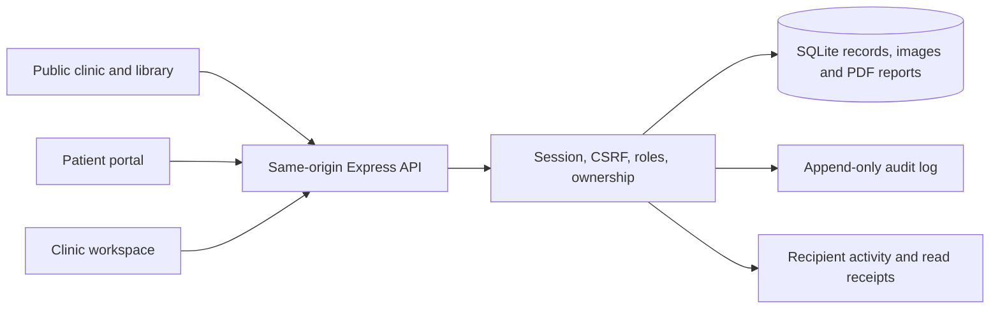

# Architecture

## Runtime

React + TypeScript + React Router render the public clinic, role-specific workspaces, and patient portal. Vite serves development assets and builds static production assets. Express runs the API and serves the built frontend from the same origin in production. Fonts are bundled locally.

Node.js 24's built-in `node:sqlite` stores application data, private image bytes and original PDF reports in a SQLite database with foreign keys and WAL mode. It currently emits an experimental-feature warning on Node 24; the tested runtime is Node 24. The application uses one synchronous database connection per server process and is intended for a modest single-clinic deployment, not a horizontally scaled cluster.

## Code map

| Path                                           | Responsibility                                                                            |
| ---------------------------------------------- | ----------------------------------------------------------------------------------------- |
| `src/App.tsx`                                  | Routing, role guards, public/clinic/patient layouts                                       |
| `src/lib.tsx`                                  | API client, session context, load/error states, notifications, date/currency helpers      |
| `src/components/ui.tsx`                        | Shared accessible UI, fields, modal focus handling                                        |
| `src/components/DocumentsPanel.tsx`            | Private PDF-report list, upload agreement and authenticated downloads                     |
| `src/components/ImageAnnotations.tsx`          | Versioned clinical overlays, explicit sharing, original images and patient viewer         |
| `src/pages/CareSummaryPage.tsx`                | Patient-facing print view and revision-checked JSON download                              |
| `server/image-annotations.ts`                  | Immutable annotation versions/publications, source provenance and private projections     |
| `server/billing-corrections.ts`                | Immutable charge corrections and mistaken-payment reversals, safe histories and revisions |
| `server/investigation-worklist.ts`             | Clinical result queues, private responsibility history and source-aware review retries    |
| `server/care-summary.ts`                       | Authorized shared-care snapshots and stale-export rejection                               |
| `src/components/PatientWaitlist.tsx`           | Patient request creation, withdrawal, history and booking links                           |
| `src/pages/PatientPages.tsx`                   | Discovery, booking, intake, patient plans, history, images, messages                      |
| `src/pages/ClinicPages.tsx`                    | Appointments, patient directory, records and treatment plans                              |
| `src/pages/FollowUpPages.tsx`                  | Clinical worklist, review history, current check-ins and review submission                |
| `src/pages/ActivityPage.tsx`                   | Account-scoped activity, cursor pagination and read-state controls                        |
| `src/pages/ClinicalWorkflowPanel.tsx`          | Investigation orders/results/reviews, procedure records and encounter amendments          |
| `src/pages/OperationsPages.tsx`                | Invoices, payments, public/managed knowledge                                              |
| `src/pages/SettingsPages.tsx`                  | Clinic configuration, staff/profiles, patient portal access, audit                        |
| `src/pages/SchedulingPage.tsx`                 | Weekly availability, consultation modes, appointment lengths, doctor/clinic time off      |
| `src/pages/WaitlistPage.tsx`                   | Staff waitlist, patient confirmation and booking from available slots                     |
| `src/pages/IdentityPages.tsx`                  | Account administration, required password rotation, sessions, recovery                    |
| `server/app.ts`                                | Core API, authorization, security headers, request validation                             |
| `server/db.ts`                                 | Schema, database utilities, synthetic demo seed                                           |
| `server/operations.ts`                         | Invoice/payment, knowledge/revision, portal-provisioning endpoints                        |
| `server/scheduling.ts`                         | Schedule/closure storage, duration-aware slot generation, booking validation              |
| `server/record-search.ts`                      | SQL-filtered staff directories and appointment/audit pages with bounded results           |
| `src/record-search.ts`                         | Query-scoped page loading, pagination validation and obsolete-response suppression        |
| `src/pages/AuditPage.tsx`                      | Administrator history search with actor/action/record/date filters                        |
| `server/clinic-resources.ts`                   | Single-unit rooms/equipment, maintenance, atomic visit reservations and immutable history |
| `src/pages/ClinicResourcesPage.tsx`            | Staff reservations diary and administrator catalogue/maintenance controls                 |
| `src/components/AppointmentResourcesModal.tsx` | Full-set allocation, source review, safe retries and visit resource history               |
| `server/waitlist.ts`                           | Immutable requests, terminal history, active claims and atomic confirmed booking          |
| `server/identity.ts`                           | Account lifecycle, session metadata migration/revocation, recovery grants                 |
| `server/documents.ts`                          | Immutable PDF originals, upload provenance, patient-scoped attachment downloads           |
| `server/clinical.ts`                           | Investigation review/publication, procedure agreement/completion, encounter amendments    |
| `server/follow-up.ts`                          | Review snapshots, owner assignments, optimistic revisions, plan state and worklist        |
| `server/patient-profile.ts`                    | Attributed demographic/allergy corrections, role projections and independent revisions    |
| `src/pages/PatientProfilePage.tsx`             | Current patient details, staff corrections and shared allergy history                     |
| `server/inventory.ts`                          | Whole-unit catalogue, immutable stock events, revisions and idempotent operations         |
| `src/pages/InventoryPage.tsx`                  | Stock catalogue, lots, histories and guarded administrator forms                          |
| `server/insights.ts`                           | Immutable expenses and voids, administrator aggregates and private CSV exports            |
| `src/pages/InsightsPage.tsx`                   | Date-range reporting, daily charts/tables and aggregate export                            |
| `src/pages/ExpensesPage.tsx`                   | Administrator expense creation, filtering and void history                                |
| `server/activity.ts`                           | Transactional recipient notifications, event deduplication and scoped read receipts       |
| `shared/`                                      | Frontend/backend data contracts                                                           |
| `tests/`                                       | Isolated API tests and real-browser workflows                                             |

## Data and security

- Every API read of private records requires a session. Patients are restricted to their `patientId`. Reception can access scheduling/demographic/waitlist/billing data and a minimal procedure-billing projection, but not clinical notes, images, reports, care plans, full clinical workflows or messages. Internal encounters/amendments, follow-up handovers and unpublished investigation interpretations are omitted from patient responses.
- Passwords are salted and hashed with scrypt. Random session tokens are hashed in the database, expire after 12 hours, and are sent only in HTTP-only SameSite cookies. Production cookies require HTTPS. Session inventory exposes an opaque hash identifier and a safe browser-family label; neither is a bearer credential.
- Authenticated writes require JSON, a matching CSRF token, and an allowed request origin. Login, registration, and token-based recovery are CSRF-exempt but still have origin/content-type checks and rate limits. Password changes and recovery-link issuance are also rate limited. Vite preserves the browser Host header when proxying API traffic.
- The server checks current account state on every request. Inactive accounts cannot log in or reuse sessions. Role, linked-doctor, or active-state changes revoke the target account’s sessions and outstanding recovery grants. Changing a password revokes other sessions and recovery grants; recovery revokes every session.
- Newly provisioned staff and patient portal accounts have `mustChangePassword=true`. Middleware blocks private application APIs until rotation; the frontend redirects to Account & security. Public information and session/password controls remain available. Public slot queries from these sessions do not use private patient availability and cannot exclude an existing appointment.
- The server validates all inputs with Zod. SQL values are parameterized; internal table names are developer-controlled constants.
- Appointment creation/rescheduling validates full time intervals for both doctor and patient inside an immediate SQLite transaction. Partial unique indexes additionally reject identical active start times. This prevents overlaps when doctors use different appointment lengths. Payment balance changes are checked within a transaction; idempotency keys distinguish retries from new invoice/payment requests.
- Private image and PDF retrieval pass the same authorization as patient records. Files have size and content-signature checks and are served with `nosniff`; SVG/HTML uploads are not accepted. PDF originals are downloaded as attachments under generated filenames and are not embedded in application pages.
- Private API responses use `Cache-Control: no-store`. No offline worker or analytics service stores or transmits medical records.
- Database triggers reject updates/deletes to audit entries, clinical encounters/amendments, clinical workflow events, follow-up reviews/assignments, waitlist requests/terminal events, procedure-invoice links, PDF originals and payment records. Activity contents are immutable while read receipts can change. This protects application-level history; it is not proof against a database/server administrator. Article revisions preserve earlier versions.
- Database and backups contain sensitive plaintext application records. Protect host storage and backups, restrict filesystem access, and configure operational monitoring before real use.

The permission model is clinic-wide for clinicians. A second organization must use a separate deployment/database until true tenancy and clinic-scoped authorization are implemented.

## Configurable scheduling

`doctorSchedules` stores each doctor’s weekly sessions and appointment length. Sessions have a weekday, start/end time, and in-person/online/both mode. Allowed lengths are 15, 20, 30, 45, and 60 minutes. Multiple non-overlapping sessions express breaks; overnight sessions are not accepted. Profiles without a saved schedule retain the original Monday–Saturday, 09:00–18:00, 30-minute default.

`scheduleClosures` stores inclusive date ranges for a doctor or the whole clinic. A closure covers either all day or a specified interval on each date. Staff can inspect closure reasons; public availability only exposes bookable times. Administrators can manage every schedule and closure, doctors can manage their linked profile, and reception has read access.

Availability uses Asia/Kolkata and a 180-day booking horizon. Slot generation excludes elapsed times, blocked periods, the doctor’s occupied intervals, and a signed-in patient’s occupied intervals. Excluding an appointment during rescheduling requires access to that appointment. Every new or rescheduled appointment records its duration; older appointments without a duration are treated as 30 minutes. Calendar export uses the recorded duration.

Schedule updates and closures run transactionally and reject changes that would invalidate active future bookings. Changing the default visit length does not rewrite existing appointments. Public clinic-hours text is separate from these bookable schedules.

## Waitlist requests and confirmed booking

`waitlistRequests` stores immutable patient/doctor, consultation mode, preferred date window, reason and creation details. `waitlistActive` is an operational claim with a unique patient/doctor/mode combination; a patient can request different modes separately but cannot create two waiting requests for the same combination. Windows are inclusive and limited to the existing 180-day booking horizon. Expiry is derived from `endDate` and the current Asia/Kolkata date. Expired claims are removed before a new request is created, while originals remain intact; no expiry job or event is invented.

`waitlistEvents` stores one terminal booking or cancellation per request with authenticated actor provenance. A booked event requires an appointment foreign key and explicit `patientConfirmed:true`; the appointment must match the request's patient, doctor, mode and date range. The ordinary scheduling checks still enforce availability and overlap. Appointment insertion, terminal event, active-claim removal, audit and patient notification occur in one immediate transaction. A unique event per request prevents two concurrent attempts from booking it twice. Repeated cancellation preserves the first event and reason; booked and expired requests cannot be cancelled or booked again.

Patients see only their own requests. Staff receive operational contact information, while patient responses omit the staff phone field. Joining reserves no capacity and creates no priority score, automatic offer or external contact. Reception records confirmation after coordinating with the patient; patients can confirm their own available slot through the booking page. An eventual appointment cancellation or reschedule does not rewrite its waitlist history. A new request is a separate record.

## Account lifecycle and recovery

Account access flags live in the user JSON record. Existing accounts without flags remain active and are not unexpectedly forced through password rotation. Role updates also change the indexed `users.role` field. Patient accounts retain their patient linkage and cannot be converted into staff; staff accounts cannot become patient accounts. Administrators cannot deactivate themselves or demote the last active administrator. Suspension preserves clinical and operational records.

`initializeIdentity` adds `createdAt` and a safe `label` to existing session tables. For legacy sessions, creation time is reconstructed from the previous fixed twelve-hour lifetime. No raw user-agent string, IP address, or device fingerprint is stored by session management.

After an administrator confirms identity, recovery creates a cryptographically random token, returns it once, and stores only its SHA-256 hash in `recoveryGrants`. A token expires after 30 minutes; a newer grant supersedes older grants for that account. Redemption checks expiry and current active status, updates the password, clears required rotation, consumes the grants, and revokes all sessions in one immediate transaction. Simultaneous redemption therefore permits only one success. The response does not sign the person in automatically.

The UI puts recovery tokens in the URL fragment, removes that fragment after loading, and submits the token in the recovery request body. Audit events identify the action and account without storing the raw token. There is no email/SMS delivery provider: verification and private link delivery remain clinic operations.

## Private reports and clinical workflow records

`documents` stores each PDF's immutable metadata and original bytes. Metadata includes the patient, authenticated uploader ID/name/role, timestamp, size and SHA-256 fingerprint. The uploader confirms private care use. Uploads use base64 JSON with a 5 MB decoded-file limit within the existing 7 MB request-body limit; canonical base64 and PDF header/end markers are checked. File names are validated for display but are never used as storage paths or download headers. Authenticated downloads use a server-generated filename, attachment disposition, sandbox CSP, `nosniff` and `no-store`.

PDFs and raster clinical images have separate types, tables and endpoints. A PDF does not become a public asset or an inline image. The application retains original bytes rather than rewriting or parsing report contents. File checks are not PDF sanitization or malware scanning, and a fingerprint does not authenticate the report's issuing organization. These boundaries also apply when the file is opened outside the browser after download.

`GET /patients/:id/clinical-workflows` assembles investigation records, procedures and consultation amendments without expanding the original `PatientRecord` contract. The patient view excludes unpublished review objects and all internal amendments. Top-level records are newest first; nested events are returned in stable insertion order. Patient-submitted result notes and uploaded reports are raw information, not clinician interpretations.

### Investigations and publication

An immutable `investigations` row records the requested test, clinical reason, patient-facing instructions, optional due date and ordering doctor. `investigationResults` holds separate immutable submissions with stable uploader identity and optional PDF references. Every linked document is validated against the same patient; a report cannot be attached across patient boundaries. Patients can submit their own report information but cannot order, review or publish an interpretation.

`investigationReviews` stores immutable clinician interpretations linked to a specific result. A review must target the latest submission, preventing a stale form from marking a newly arrived report reviewed. `investigationPublications` records the separate explicit action that makes an interpretation patient-visible. Publishing never alters the review text. Additional interpretations retain their predecessors, and audit events identify review and publication separately.

Status is derived from those events: an order with no result is `ordered`; a latest result without review is `result-received`; a latest result with a clinician review is `reviewed`. A supplemental submission therefore requires a fresh review while preserving earlier interpretations. An entry in `investigationCancellations` makes the order terminal without deleting its earlier documentation. The service performs no diagnosis, result classification or automatic laboratory communication.

### Procedure plans and patient decisions

`procedures` holds an immutable explanation of indication, expected benefits, risks, alternatives, aftercare and estimated cost. Optional appointment linkage is restricted to the same patient and reuses the existing booking; the procedure workflow does not reserve another slot or create an invoice.

`procedureAgreements` records each decision as a distinct event. An authenticated owning patient may agree or decline through the portal. A linked clinician can record an in-person/phone decision only with an explicit confirmation and discussion note. The record distinguishes the actual recording user, their role and the method; a clinician cannot submit a patient-portal acknowledgement. Because the plan is immutable, a decision always refers to the exact explanation the patient was shown. If the explanation changes, the clinician creates a new plan.

`procedureCompletions` and `procedureCancellations` are separate terminal events. Completion requires the latest decision to be agreed and records outcome, aftercare and the responsible doctor. A linked visit cannot be cancelled/no-show or have a start time still in the future. Decision, cancellation and completion checks use immediate transactions so a concurrent withdrawal cannot leave a completed record whose latest decision is declined. Completion or cancellation leaves the linked appointment unchanged.

These events record communication and reported decisions; they are not an electronic signature system or an assurance that all consent requirements have been met. Medication safety checks, clinical protocol validation, pathology interpretation and external laboratory connections remain outside this implementation.

### Procedure billing linkage

`procedureInvoiceLinks` connects one procedure to one invoice, with unique constraints on both IDs and update/delete rejection triggers. Staff create the invoice explicitly, with the same patient and an eligible procedure; a cancelled procedure cannot receive a new link. Invoice creation, sequence allocation, linkage, audit and patient activity commit in one immediate transaction. Simultaneous attempts cannot create a second charge for that procedure. Matching request-ID retries return the existing invoice, including after a later procedure cancellation; changed request content returns `409`.

The billing projection contains only patient identity, procedure title, recorded cost estimate, operational status and linked invoice identity. Reception cannot retrieve indication, benefits, risks, alternatives, aftercare, decision notes or outcomes through this projection or the clinical endpoint. The linked invoice retains the procedure title as a snapshot. Clinical staff can navigate between the procedure and billing; reception remains in the billing workspace.

Estimates are descriptive text and never parsed into invoice amounts. Staff enter agreed charges explicitly as positive integer paise, with server-derived totals and an unpaid initial state. A procedure does not automatically issue an invoice; an invoice does not record a received payment. Procedure cancellation preserves existing invoices and payments, with no automated refund, tax or payment-provider operation.

### Amendments and clinical authorship

`encounterAmendments` adds a reasoned, timestamped entry linked to the original consultation and patient. It never updates the original encounter and remains clinician-only. Clinical order, interpretation, amendment, procedure-plan and completion authorship requires a valid doctor profile linked to the authenticated account. An unlinked administrator can manage access and inspect authorized records but cannot be silently attributed to another doctor.

All new clinical tables have update/delete rejection triggers. Status, publication and completion are represented by additional rows instead of edits to earlier explanations or decisions. The database-level guards complement endpoint permissions and preserve application history; administrative database access remains a separate trust boundary.

## Follow-up review and preserved evidence

`followUpReviews` stores immutable clinician reviews and explicitly identified status-only events. Each clinical review includes an internal assessment, patient-facing instructions, the linked doctor, disposition and next review date. Patient responses strip internal assessments and check-in snapshots at every entry point, including plan lists, patient records and review history. Reception has no access. The worklist defaults to the clinician's currently assigned care plans; authorized clinicians can inspect the whole clinic. Completed plans remain available for history and filtering.

Check-ins retain the original one-record-per-plan/day behavior. A review captures the complete submitted check-ins as immutable snapshots with their IDs, submission timestamps and canonical SHA-256 fingerprints. A same-day replacement can therefore re-enter the review queue without erasing evidence captured by earlier reviews. A current check-in counts as reviewed only when its version matches the latest clinical review's snapshot. Merely reading an activity item or changing plan status does not acknowledge that clinical information.

The review revision hashes the relevant care-plan fields, latest review ID, latest assignment ID and current check-in versions. Review submission requires that exact revision inside an immediate transaction. A concurrent review, handover or check-in change returns `409` rather than silently signing stale information. The review, operational plan status, audit entry and generic patient notification commit together. Clinical text and snapshot content are derived or validated on the server; notifications contain no internal assessment.

`followUpAssignments` stores immutable handovers: previous/new doctor IDs and names, reason, assigning account and timestamp. Ownership defaults to the original author until the latest assignment changes it; original plan and review authorship remain untouched. Administrators can reassign any plan, including without a linked clinical profile, while doctors may reassign only plans they currently own. The destination must have an active linked doctor/administrator account. Assignments require the current revision, reject the same owner and commit with their audit entry and generic new-owner activity. They neither clear unreviewed check-ins nor change treatment or review dates. Assignment reasons/history are clinician-only and are absent from patient records, reviews and notifications. Operational handover remains available while the follow-up module is paused.

Hydration exposes `effectiveStatus`, `effectiveFollowUpDate`, `followUpRevision` and `latestReview` without rewriting original treatment dates or instructions. The latest review determines the effective next review date and active/completed state. Dashboard due counts use active plans whose effective date is today or earlier. Closing a plan prevents new check-ins; reopening or continuing follow-up does not extend the original treatment period. Requesting a visit records instructions but does not create an appointment.

The legacy status endpoint appends a `source:'status-change'` event with factual patient text, while leaving the latest clinical review's acknowledgement boundary intact. It accepts an optional revision for existing-client compatibility and makes a repeated current status a no-op. New clinical reviews and check-ins require the follow-up module; existing history and status-only closure remain accessible when that module is disabled. These workflows support clinician documentation and patient reporting, without automatic diagnosis, risk classification or treatment generation.

## Recipient activity and read receipts

`activity` stores one immutable notification per recipient and source-event key, enforced by `UNIQUE(userId,eventKey)`. Appointment, waitlist, care-plan, handover, message, check-in, clinical workflow, invoice and received-payment mutations write their notifications in the same SQLite transaction as the source record. A waitlist booking emits one request-specific booking update, suppressing the duplicate ordinary appointment-created update. A notification failure rolls back the source mutation, so the application does not return a partially saved event. There is no independent delivery worker or external message transport.

Only active accounts receive newly created events. Patient notifications resolve to accounts linked to that patient. Assigned clinical events resolve to active clinician accounts linked to the owning doctor; subsequent check-ins use the latest follow-up owner. If no owner account is active, events fall back to the active linked clinical team. Recipient selection precedes author exclusion, preventing an author's own event from being incorrectly rerouted. General patient messages notify the active clinical team. New or reactivated accounts do not receive historical backfill.

Feed reads are scoped by current account ID and audience, with an additional patient-ID condition for patients. Reception's scope is empty, and current authorization still applies to old entries after a role change. Feed content uses safe server-generated summaries and internal links; message bodies, internal assessments and unpublished interpretations are not copied into notifications.

Pagination resolves an opaque item ID to a recipient-scoped SQLite row position and returns older rows. New arrivals do not shift an existing cursor. `unreadCount` covers the entire permitted feed. Listing has no read side effect. Individual reads preserve the first receipt timestamp; bulk reads mark all eligible older rows through the supplied snapshot ID, including unloaded pages, while preserving newer arrivals. Receipt updates and their audit entries commit together; audit failures leave items unread. Read state is separate from clinical review state and does not clear a follow-up worklist entry. The inbox provides in-app updates only, with no scheduled reminders, email/SMS/push integration or emergency-monitoring service.

## Expense evidence and reporting periods

`expenses` stores immutable original entries and a unique request UUID. `expenseVoids` adds one immutable, attributed correction per expense with a required reason. Database triggers reject updates and deletion of both originals and corrections. Immediate transactions couple each create/void with its audit entry; an identical create retry returns the original record, and changed request details conflict. A void never initiates a bank operation or edits an invoice/payment. Administrators alone can access the ledger and report endpoints.

The aggregation function converts invoice and payment timestamps to Asia/Kolkata dates, uses appointment scheduled dates and expense incurred dates, and fills every selected day with a result. Ranges are real, ordered dates with at most 366 inclusive days. Counts use current appointment states and expense void state. Current outstanding is limited to the cohort of invoices issued in the range; payment totals exclude reversed erroneous entries and use their original recording date independently of invoice issue date. Invoice amounts use current corrected charges in the original issue-date cohort. Safe integer aggregation preserves paise without floating-point currency arithmetic and rejects totals outside representable bounds.

JSON and CSV reuse the same aggregate builder. CSV contains fixed report sections and aggregate amounts/counts, without patient identifiers or expense free text. Values use CSV quoting and formula-prefix protection. Read/export audit events record the requested period. There is no asynchronous warehouse, historical as-of ledger reconstruction, revenue-recognition, tax or profit calculation. The UI explains the selected dates and separates invoices, recorded collections and incurred expenses.

## Original images, overlays and patient-facing export

Original image rows now reject updates and deletion. New uploads store SHA-256, byte count and authenticated uploader identity; the original insert and audit commit together. Legacy metadata remains readable without fabricated uploader fields. `imageAnnotationVersions` stores immutable, attributed notes and bounded normalized geometry alongside the original-byte fingerprint. `imageAnnotationPublications` records the separate decision to share one immutable version. Linked clinicians alone can save/publish, and both operations respect the image-module pause. A stale revision rejects a save/publication, and only the newest saved version can be newly shared. Previously published versions remain visible when later private drafts exist.

Annotation geometry is typed data rendered as a controlled SVG overlay, not uploaded SVG or modified raster content. Text legends and numeric percentage controls provide the same operations without pointer dragging. Patient history and the published-summary helper use explicit projections and omit private revision state and internal account provenance. Generic patient activity is created only on publication.

`server/care-summary.ts` composes a patient-facing snapshot for both clinical staff and owning patients. It reuses the clinical workflow's patient projection and follow-up's safe review projection, selects shared care-plan fields explicitly, and includes only published annotations. Messages, internal notes/amendments, private assessment/snapshot/assignment fields and file bytes never enter the response. Each read/download runs with patient authorization and audit in one transaction. A hash of visible content excludes generation time and private revisions; JSON downloads require that hash to remain current. Private-only updates and paused modules therefore preserve export access, while changed shared results or payment balances require a refresh. The UI validates the returned patient, audience and revision before saving JSON and cancels stale downloads when its displayed snapshot changes.

## Current patient details and correction evidence

`patientProfileChanges` retains demographic before/after snapshots, reasons and staff attribution; `patientAllergyChanges` separately retains clinical status/text changes, patient-visible reasons and clinician attribution. `patientProfileCommands` reserves actor-bound request UUIDs across these correction operations. All three source tables reject updates/deletion. Each mutation updates the current Patient row and appends evidence, command receipt and audit in one immediate transaction. Historical clinical/billing/appointment originals and account credentials are unaffected.

Demographic revisions depend only on current demographic fields and the latest demographic change. Allergy revisions depend only on the clinical stream. Reception receives explicit operational projections without allergy status, text or editing tokens. Owning patients receive current demographics without internal correction history, plus a safe allergy history. Care summaries reuse that safe history and include it in their visible-content revision. Legacy status is derived without fabricated reviews. Browser drafts retain the attempted payload through uncertain responses, require explicit stale-context review, and suppress late completion feedback after leaving the page.

## Consumable stock and retained evidence

Inventory separates fixed item identity (SKU and whole-unit counting basis), attributed catalogue snapshots, immutable receipt lots and append-only movements. Current item metadata comes from the latest snapshot; lot balances come from signed movement sums. Derived item totals classify lots against the clinic date. Unknown expiry remains distinguishable from a recorded date, and expired stock is excluded from consumption and low-stock availability calculations.

Every administrator write uses an immediate transaction. A shared request registry binds UUIDs to actor, operation and normalized payload before performing revision checks. A retry after an uncertain response returns the already recorded event with current detail; altered payloads cannot reuse its key. The revision includes the latest catalogue/stock evidence and clinic date. Competing changes and midnight rollover therefore reject stale form context before checking nonnegative lot and bounded item totals. Original events, request receipt and audit commit together.

Staff may read inventory without access to any patient information through these endpoints. Only administrators can change the catalogue or stock. Archive preserves all lots and evidence; physical counts can reconcile inactive/expired stock. The ledger uses item-scoped, stable row cursors. The UI keeps an uncertain submitted payload/UUID locked for exact replay while the inventory page remains mounted, validates successful stock responses before clearing it, and ignores late navigation effects after leaving the route. Local unfinished drafts do not survive a page reload or session end. There are no automatic transfers to invoices, expenses, prescriptions, procurement or activity notifications. This is a single-location consumable register, not a pharmacy dispensing system.

## Verification strategy

API tests create isolated databases and real temporary HTTP servers. They assert unauthorized access, database-backed invariants, monetary arithmetic, concurrency, and persistence. Scheduling tests include breaks, modes, closures, protected bookings, interval overlap, and temporary-password privacy. Waitlist tests cover patient scope, active-request uniqueness, expiry, confirmation, atomic booking and retained terminal history. Identity tests include access changes, session ownership, recovery replay/expiry, rate limits, and migrations from the previous session schema. Report tests check exact bytes, digest/provenance, size/format rejection, private downloads and immutability. Clinical workflow tests cover same-patient report linkage, unpublished interpretation privacy, latest-result review, original-note preservation, explicit decision histories, visit timing and concurrent withdrawal/completion. Procedure billing tests cover minimal reception projection, patient matching, exact amounts, retry/concurrency protection and immutable linkage after cancellation. Follow-up tests cover snapshot preservation, same-day edits, stale/concurrent review rejection, handover authority/revisions/privacy, patient filtering, effective dates and status-only compatibility. Activity tests cover recipient and role isolation, owner routing, inactive-owner fallback, stable pagination, bounded bulk reads, deduplication, publication privacy and source-event rollback. Browser tests exercise user workflows through rendered forms and verify their saved outcomes. Each browser-suite run uses its own temporary database and dedicated ports, leaving the local demonstration database alone.

Implementation references: [Node.js SQLite API](https://nodejs.org/docs/latest-v24.x/api/sqlite.html), [Express production security guidance](https://expressjs.com/en/advanced/best-practice-security.html). The code and tests define this release's actual guarantees.

## Invoice corrections and erroneous payment entries

`server/billing-corrections.ts` adds immutable `invoiceIssuedCharges`, `invoiceCorrections`, `paymentReversals` and `billingCorrectionCommands` tables. Existing invoices retain their current data; the known original charge lines are captured before the first correction, without inventing an issue author or date. Source payment rows remain append-only. A composite payment/invoice foreign key and unique payment reversal prevent cross-invoice or duplicate reversals. Current invoice identity, patient-name snapshot, issue date and procedure linkage stay fixed while charges, net paid and derived status change.

Administrator commands run inside an immediate transaction with a current-detail hash, actor-bound replay receipt, immutable event, current invoice update, audit and generic patient activity. Replay checks precede revision checks and compare normalized intent without the old revision. New corrections cannot undercut net paid; removing all charges requires explicit confirmation and zero net paid. `no-charge` distinguishes an empty corrected invoice from a paid one. Reversals require explicit confirmation that the entire payment entry was erroneous and subtract it from net paid without changing or deleting the source payment. This is not a refund or money-transfer workflow.

`invoiceDetail` returns current charges, all original payments, safe correction/reversal history, original issued charges and a revision spanning those records. Safe history excludes internal account/request IDs and explicitly shares reasons. Original invoice creation retries compare issued charges; original payment retries after reversal return the current balance without restoring that entry. Reports exclude reversal IDs at the payment's original recording date and use current invoice charges in the original issue-date period. Patient care summaries include safe histories, so shared corrections invalidate an older export revision.

The billing page retains a submitted payload and request ID during an uncertain response, validates the matching saved event before clearing it and requires explicit review of concurrent changes. Unfinished drafts are held in memory while the billing page remains open. Admin controls are absent for other readers; server authorization independently enforces the same restriction. Nested response validation rejects incomplete or inconsistent financial records before rendering, and a matching historical correction cannot falsely confirm a new request. Printing temporarily expands invoice history and restores its previous disclosure state afterward. Dialog focus skips collapsed disclosure contents, including browsers that retain their layout rectangles.

## Appointment resources

`server/clinic-resources.ts` owns a separate staff projection for physical rooms and equipment. Each catalogue item has capacity one; no fields are added to the core `Appointment` DTO or patient summaries. Current claims are indexed by resource and interval; overlapping claims are rejected inside an immediate transaction and by an additional SQLite overlap trigger. Catalogue changes, maintenance originals/cancellations and allocation snapshots remain immutable, with actor-bound command receipts for safe retries. Explicit mutation events expose their canonical request ID to staff so the browser confirms the exact command, author and values before clearing a submitted draft. Metadata forms omit active state; archive and restore remain separate explicit operations even after stale-context review.

The appointment PATCH handler invokes the resource change hook within the existing scheduling transaction, before updating the appointment. A reschedule replaces every retained claim using the new full duration, or rolls back the appointment, claims, history, audit and notification. Cancellation/no-show releases claims. Completion keeps the scheduled interval. Authorized reschedule slot reads apply the same resource availability predicate, while authoritative write checks still handle intervening changes.

Resource allocation contexts contain operational appointment identities and independent revision tokens. Patient reschedules receive only a generic conflict; staff resource changes produce no patient activity and do not alter shared care-summary revisions. Open appointments can release stale allocations after their scheduled end, while terminal allocation histories remain read-only. The system does not infer live room occupancy, extend overruns or allocate resources to new bookings automatically.

## Investigation review coordination

`server/investigation-worklist.ts` is registered inside the clinical module and derives work items from original orders and their immutable events. Worklist/detail DTOs are separate from the patient-facing `Investigation` type. Results/reviews remain ordered by insertion; only the latest result determines review status. The most recent review of that result supplies the separate publication indicator. Original requested dates describe missing results only and are not repurposed as review deadlines.

`investigationAssignments` records immutable handovers; an absent assignment means the ordering clinician is responsible. Eligible owners derive from current active linked clinical accounts. Queue responsibility changes neither original authorship nor clinical access. New-result activity follows current ownership and preserves the source result in its link. Assignment activity uses generic text and exposes no private reason. All clinic work remains discoverable even if the owner has no active account.

A source hash spans the investigation projection and immutable assignment IDs. `investigationCommands` binds a UUID to the actor, operation, investigation, normalized payload and saved event. Review forms submit the hash and UUID together. Replay occurs before source/ownership checks, while current account and patient authorization still apply. New events, replay receipt, audits and notifications use one immediate transaction. Legacy review callers may omit both tokens, retaining their original latest-result check. New publication on cancelled investigations is denied while already published retries preserve the source timestamp.

The queue and dashboard use private clinical worklist endpoints. Shared review dialogs load current result notes, safe authenticated report links and earlier reviews; controlled drafts survive context conflicts, and uncertain writes retain an exact retry. Handover drafts likewise require explicit refreshed-context review. Internal handover data never enters patient workflows or care summaries. Exact workup links reveal and focus their target, including earlier results and cancelled records, without changing review completion or activity read state.

## Bounded staff record search

`server/record-search.ts` registers additive staff-only directory and appointment search, and administrator-only audit search. Built-in JSON expression indexes and existing relational columns support common sort/filter paths without application-defined SQLite functions. Parameterized `instr` performs literal substring matches; it uses SQLite ASCII case folding and can still scan candidate rows. Search does not decode whole collections into Node memory.

Count and page selection share one read transaction, return at most 100 rows (25 in the UI), and clamp out-of-range pages after data changes. Separate requests intentionally show current records: offset pagination is not a frozen snapshot. Patient directory fields are selected explicitly in SQL, so allergies and private notes neither appear nor affect result counts. Appointment searches may join current demographics while preserving the original appointment projection. Audit reads preserve historical actor names and do not write recursive audit events.

`useSearchPage` associates data/loading/error with the exact request path, rejects malformed pagination metadata and ignores late responses for older filters. Shared pagination and URL-backed views support refresh, page changes and browser navigation. Existing booking patient selectors and patient record routes remain on their compatible APIs; this release does not claim to paginate every record or report endpoint.
