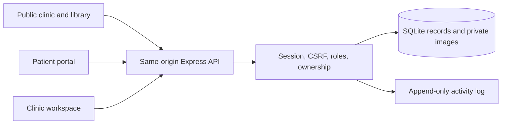

# Architecture

## Runtime

React + TypeScript + React Router render the public clinic, role-specific workspaces, and patient portal. Vite serves development assets and builds static production assets. Express runs the API and serves the built frontend from the same origin in production. Fonts are bundled locally.

Node.js 24's built-in `node:sqlite` stores application data and private image bytes in a SQLite database with foreign keys and WAL mode. It currently emits an experimental-feature warning on Node 24; the tested runtime is Node 24. The application uses one synchronous database connection per server process and is intended for a modest single-clinic deployment, not a horizontally scaled cluster.

## Code map

| Path                            | Responsibility                                                                       |
| ------------------------------- | ------------------------------------------------------------------------------------ |
| `src/App.tsx`                   | Routing, role guards, public/clinic/patient layouts                                  |
| `src/lib.tsx`                   | API client, session context, load/error states, notifications, date/currency helpers |
| `src/components/ui.tsx`         | Shared accessible UI, fields, modal focus handling                                   |
| `src/pages/PatientPages.tsx`    | Discovery, booking, intake, patient plans, history, images, messages                 |
| `src/pages/ClinicPages.tsx`     | Appointments, patient directory, records, treatment plans, follow-up lists           |
| `src/pages/OperationsPages.tsx` | Invoices, payments, public/managed knowledge                                         |
| `src/pages/SettingsPages.tsx`   | Clinic configuration, staff/profiles, patient portal access, audit                   |
| `src/pages/SchedulingPage.tsx`  | Weekly availability, consultation modes, appointment lengths, doctor/clinic time off |
| `src/pages/IdentityPages.tsx`   | Account administration, required password rotation, sessions, recovery               |
| `server/app.ts`                 | Core API, authorization, security headers, request validation                        |
| `server/db.ts`                  | Schema, database utilities, synthetic demo seed                                      |
| `server/operations.ts`          | Invoice/payment, knowledge/revision, portal-provisioning endpoints                   |
| `server/scheduling.ts`          | Schedule/closure storage, duration-aware slot generation, booking validation         |
| `server/identity.ts`            | Account lifecycle, session metadata migration/revocation, recovery grants            |
| `shared/`                       | Frontend/backend data contracts                                                      |
| `tests/`                        | Isolated API tests and real-browser workflows                                        |

## Data and security

- Every API read of private records requires a session. Patients are restricted to their `patientId`. Reception can access scheduling/demographic/billing data but not clinical notes, images, care plans, or messages.
- Passwords are salted and hashed with scrypt. Random session tokens are hashed in the database, expire after 12 hours, and are sent only in HTTP-only SameSite cookies. Production cookies require HTTPS. Session inventory exposes an opaque hash identifier and a safe browser-family label; neither is a bearer credential.
- Authenticated writes require JSON, a matching CSRF token, and an allowed request origin. Login, registration, and token-based recovery are CSRF-exempt but still have origin/content-type checks and rate limits. Password changes and recovery-link issuance are also rate limited. Vite preserves the browser Host header when proxying API traffic.
- The server checks current account state on every request. Inactive accounts cannot log in or reuse sessions. Role, linked-doctor, or active-state changes revoke the target account’s sessions and outstanding recovery grants. Changing a password revokes other sessions and recovery grants; recovery revokes every session.
- Newly provisioned staff and patient portal accounts have `mustChangePassword=true`. Middleware blocks private application APIs until rotation; the frontend redirects to Account & security. Public information and session/password controls remain available. Public slot queries from these sessions do not use private patient availability and cannot exclude an existing appointment.
- The server validates all inputs with Zod. SQL values are parameterized; internal table names are developer-controlled constants.
- Appointment creation/rescheduling validates full time intervals for both doctor and patient inside an immediate SQLite transaction. Partial unique indexes additionally reject identical active start times. This prevents overlaps when doctors use different appointment lengths. Payment balance changes are checked within a transaction; idempotency keys distinguish retries from new invoice/payment requests.
- Private image retrieval passes the same authorization as patient records. Files have size and content-signature checks and are served with `nosniff`; SVG/HTML are not accepted.
- Private API responses use `Cache-Control: no-store`. No offline worker or analytics service stores or transmits medical records.
- Database triggers reject updates/deletes to audit entries, clinical encounters, and payment records. This protects application-level history; it is not proof against a database/server administrator. Article revisions preserve earlier versions.
- Database and backups contain sensitive plaintext application records. Protect host storage and backups, restrict filesystem access, and configure operational monitoring before real use.

The permission model is clinic-wide for clinicians. A second organization must use a separate deployment/database until true tenancy and clinic-scoped authorization are implemented.

## Configurable scheduling

`doctorSchedules` stores each doctor’s weekly sessions and appointment length. Sessions have a weekday, start/end time, and in-person/online/both mode. Allowed lengths are 15, 20, 30, 45, and 60 minutes. Multiple non-overlapping sessions express breaks; overnight sessions are not accepted. Profiles without a saved schedule retain the original Monday–Saturday, 09:00–18:00, 30-minute default.

`scheduleClosures` stores inclusive date ranges for a doctor or the whole clinic. A closure covers either all day or a specified interval on each date. Staff can inspect closure reasons; public availability only exposes bookable times. Administrators can manage every schedule and closure, doctors can manage their linked profile, and reception has read access.

Availability uses Asia/Kolkata and a 180-day booking horizon. Slot generation excludes elapsed times, blocked periods, the doctor’s occupied intervals, and a signed-in patient’s occupied intervals. Excluding an appointment during rescheduling requires access to that appointment. Every new or rescheduled appointment records its duration; older appointments without a duration are treated as 30 minutes. Calendar export uses the recorded duration.

Schedule updates and closures run transactionally and reject changes that would invalidate active future bookings. Changing the default visit length does not rewrite existing appointments. Public clinic-hours text is separate from these bookable schedules.

## Account lifecycle and recovery

Account access flags live in the user JSON record. Existing accounts without flags remain active and are not unexpectedly forced through password rotation. Role updates also change the indexed `users.role` field. Patient accounts retain their patient linkage and cannot be converted into staff; staff accounts cannot become patient accounts. Administrators cannot deactivate themselves or demote the last active administrator. Suspension preserves clinical and operational records.

`initializeIdentity` adds `createdAt` and a safe `label` to existing session tables. For legacy sessions, creation time is reconstructed from the previous fixed twelve-hour lifetime. No raw user-agent string, IP address, or device fingerprint is stored by session management.

After an administrator confirms identity, recovery creates a cryptographically random token, returns it once, and stores only its SHA-256 hash in `recoveryGrants`. A token expires after 30 minutes; a newer grant supersedes older grants for that account. Redemption checks expiry and current active status, updates the password, clears required rotation, consumes the grants, and revokes all sessions in one immediate transaction. Simultaneous redemption therefore permits only one success. The response does not sign the person in automatically.

The UI puts recovery tokens in the URL fragment, removes that fragment after loading, and submits the token in the recovery request body. Audit events identify the action and account without storing the raw token. There is no email/SMS delivery provider: verification and private link delivery remain clinic operations.

## Verification strategy

API tests create isolated databases and real temporary HTTP servers. They assert unauthorized access, database-backed invariants, monetary arithmetic, concurrency, and persistence. Scheduling tests include breaks, modes, closures, protected bookings, interval overlap, and temporary-password privacy. Identity tests include access changes, session ownership, recovery replay/expiry, rate limits, and migrations from the previous session schema. Browser tests exercise user workflows through rendered forms and verify their saved outcomes. Each browser-suite run uses its own temporary database and dedicated ports, leaving the local demonstration database alone.

Implementation references: [Node.js SQLite API](https://nodejs.org/docs/latest-v24.x/api/sqlite.html), [Express production security guidance](https://expressjs.com/en/advanced/best-practice-security.html). The code and tests define this release's actual guarantees.
