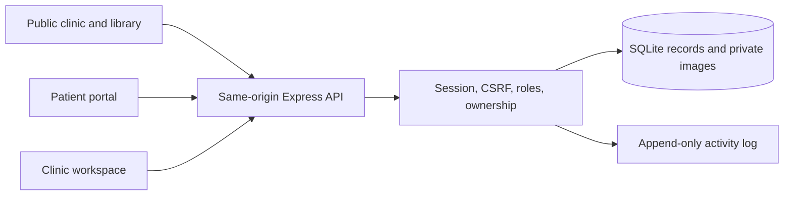

# Architecture

## Runtime

React + TypeScript + React Router render the public clinic, role-specific workspaces, and patient portal. Vite serves development assets and builds static production assets. Express runs the API and serves the built frontend from the same origin in production. Fonts are bundled locally.

Node.js 24's built-in `node:sqlite` stores application data and private image bytes in a SQLite database with foreign keys and WAL mode. It currently emits an experimental-feature warning on Node 24; the tested runtime is Node 24. The application uses one synchronous database connection per server process and is intended for a modest single-clinic deployment, not a horizontally scaled cluster.

## Code map

| Path                            | Responsibility                                                                       |
| ------------------------------- | ------------------------------------------------------------------------------------ |
| `src/App.tsx`                   | Routing, role guards, public/clinic/patient layouts                                  |
| `src/lib.tsx`                   | API client, session context, load/error states, notifications, date/currency helpers |
| `src/components/ui.tsx`         | Shared accessible UI, fields, modal focus handling                                   |
| `src/pages/PatientPages.tsx`    | Discovery, booking, intake, patient plans, history, images, messages                 |
| `src/pages/ClinicPages.tsx`     | Appointments, patient directory, records, treatment plans, follow-up lists           |
| `src/pages/OperationsPages.tsx` | Invoices, payments, public/managed knowledge                                         |
| `src/pages/SettingsPages.tsx`   | Clinic configuration, staff/profiles, patient portal access, audit                   |
| `server/app.ts`                 | Core API, authorization, security headers, request validation                        |
| `server/db.ts`                  | Schema, database utilities, synthetic demo seed                                      |
| `server/operations.ts`          | Invoice/payment, knowledge/revision, portal-provisioning endpoints                   |
| `shared/`                       | Frontend/backend data contracts                                                      |
| `tests/`                        | Isolated API tests and real-browser workflows                                        |

## Data and security

- Every API read of private records requires a session. Patients are restricted to their `patientId`. Reception can access scheduling/demographic/billing data but not clinical notes, images, care plans, or messages.
- Passwords are salted and hashed with scrypt. Random session tokens are hashed in the database, expire after 12 hours, and are sent only in HTTP-only SameSite cookies. Production cookies require HTTPS.
- Writes require JSON, a matching CSRF token, and an allowed request origin. Authentication endpoints have origin checks and rate limits. Vite preserves the browser Host header when proxying API traffic.
- The server validates all inputs with Zod. SQL values are parameterized; internal table names are developer-controlled constants.
- Patient and doctor slot uniqueness is enforced by partial database indexes. Payment balance changes are checked within a transaction. Idempotency keys distinguish retries from new invoice/payment requests.
- Private image retrieval passes the same authorization as patient records. Files have size and content-signature checks and are served with `nosniff`; SVG/HTML are not accepted.
- Private API responses use `Cache-Control: no-store`. No offline worker or analytics service stores or transmits medical records.
- Database triggers reject updates/deletes to audit entries, clinical encounters, and payment records. This protects application-level history; it is not proof against a database/server administrator. Article revisions preserve earlier versions.
- Database and backups contain sensitive plaintext application records. Protect host storage and backups, restrict filesystem access, and configure operational monitoring before real use.

The permission model is clinic-wide for clinicians. A second organization must use a separate deployment/database until true tenancy and clinic-scoped authorization are implemented.

## Verification strategy

API tests create isolated databases and real temporary HTTP servers. They assert unauthorized access, database-backed invariants, monetary arithmetic, concurrency, and persistence. Browser tests exercise user workflows through rendered forms and verify their saved outcomes. Each browser-suite run uses its own temporary database and dedicated ports, leaving the local demonstration database alone.

Implementation references: [Node.js SQLite API](https://nodejs.org/docs/latest-v24.x/api/sqlite.html), [Express production security guidance](https://expressjs.com/en/advanced/best-practice-security.html). The code and tests define this release's actual guarantees.
